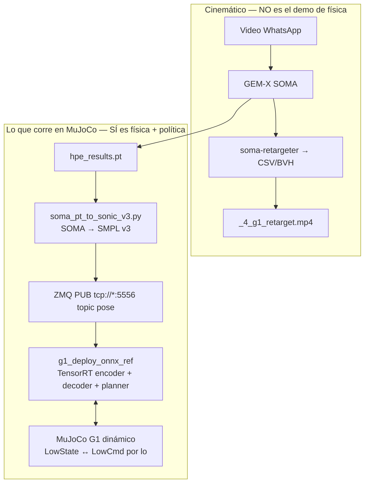

# MI GUÍA — GR00T / GEAR-SONIC en esta laptop

Documento **personal**. No es el README oficial. Es el mapa de lo que ya corre aquí, por qué, y qué comando copiar.

Última actualización: 13 ago 2026.

---

## 0. En una frase

Quieres que un **Unitree G1** imite **tus videos** (o una cámara). El video no mueve al robot. Pasa por:

```
video / webcam
    → GEM-X (pose 3D humana, modelo SOMA)
    → conversión a SMPL (24 joints)
    → política SONIC (red neuronal de whole-body control)
    → comandos de motor
    → G1 en física (MuJoCo o Isaac Lab)  o  G1 real
```

El mp4 `_4_g1_retarget.mp4` **no** es eso. Ese es un esqueleto animado **sin física**. Lo de las 3 terminales **sí** es física + política.

---

## 1. Qué es cada cosa (vocabulario)

| Nombre | Qué es | Qué no es |
|---|---|---|
| **GR00T-WholeBodyControl** | El repo NVIDIA (`~/GR00T-WholeBodyControl`). Contiene SONIC, deploy C++, MuJoCo, Isaac Lab wrappers. | No es GR00T VLA (N1.5/N1.6 visión-lenguaje). Eso es otro modelo. |
| **GEAR-SONIC** | Controlador de cuerpo completo (WBC) del G1. Política RL + encoders (SMPL, 3-point, etc.). | No es el estimador de pose. No “entiende” el video. |
| **GEM-X** | Repo aparte (`~/GEM-X`). Estima pose humana 3D (SOMA) desde imagen. | No controla el robot. |
| **SOMA** | Modelo de cuerpo humano de GEM-X (~77 joints). | No es el G1. |
| **SMPL** | Modelo humano clásico de 24 joints. SONIC tiene un encoder `smpl` (modo 2) entrenado para mapear humano → robot. | No es cinemática del G1. |
| **Retarget cinemático** | Copiar ángulos humanos al esqueleto G1 (CSV/BVH/mp4). | Sin masa, sin suelo, sin equilibrio. |
| **MuJoCo** | Simulador de **dinámica**: masas, inercias, contactos, gravedad, actuadores. | No es Isaac Sim. |
| **Isaac Lab / Isaac Sim** | El otro simulador (GPU, USD). Ahí corriste el eval con GUI. | Más pesado; no es el deploy C++ TensorRT. |
| **Deploy C++** (`g1_deploy_onnx_ref`) | Inferencia en tiempo real: ONNX → TensorRT, lee `LowState`, publica `LowCmd`. | En sim habla con MuJoCo por `lo` (loopback). En real hablaría con el G1. |
| **LowState** | Feedback: IMU + `q`/`dq` de 29 motores. | Si no llega, el control no arranca. |
| **LowCmd** | Comandos: `q_target`, `kp`, `kd`. | Lo que MuJoCo/el robot ejecuta. |
| **Planner** | Red aparte (`planner_sonic.onnx`) que genera locomoción (caminar, correr) desde teclado WASD. | **No** es el baile del video. |
| **ZMQ pose** | Socket (puerto **5556**, topic `pose`) por donde entra el SMPL del video. | Distinto del ZMQ de *output* y del planner. |
| **CRC** | Checksum de paquetes Unitree. El robot real lo llena. **MuJoCo lo deja en 0**. | Sin `--disable-crc-check` el deploy tira todos los paquetes. |

### Tres “G1” distintos (no los mezcles)

1. **G1 cinemático** — huesos + ángulos. El mp4 de retarget. Isaac/Blender style playback.
2. **G1 dinámico (sim)** — MJCF/URDF con física. `run_sim_loop.py` o Isaac Lab.
3. **G1 real** — hardware Unitree. Mismo binario de deploy, otra interfaz de red (`eth0`/`enp…`), **con CRC**.

---

## 2. Esta máquina

- Ubuntu 22.04, Alienware 16, **RTX 5070 Ti Laptop** (~11–12 GB VRAM), driver 580, CUDA 13.0, sm_120.
- Disco suele ir muy lleno; no bajes otro TensorRT “por si acaso”.
- ROS Humble está instalado. **No lo uses** para este demo: ensucia `PYTHONPATH` (`scripts` de ROS tapa `scripts` de GEM-X) y `--output-type all` intenta ROS2 y truena.

### Rutas fijas

```
Repo SONIC:     /home/emendezj/GR00T-WholeBodyControl
GEM-X:          /home/emendezj/GEM-X
TensorRT 10.13: ~/TensorRT  →  ~/TensorRT-10.13.3.9
ONNX Runtime:   ~/.local/onnxruntime
just:           ~/.local/bin/just
msgpack headers:~/.local/include

Video WhatsApp: ~/Downloads/WhatsApp Video 2026-08-13 at 4.51.33 PM.mp4
GEM-X output:   /tmp/gemx_baile/WhatsApp Video 2026-08-13 at 4.51.33 PM/
  hpe_results.pt              ← poses SOMA (323 frames)  ★ esto alimenta SONIC
  *_4_g1_retarget.mp4         ← cinemático (solo para ver)
  *_retarget_g1.csv / .bvh    ← retarget cinemático
```

`/tmp` se borra al reiniciar. Si quieres guardar el baile, copia `hpe_results.pt` fuera de `/tmp`.

### Entornos Python — NUNCA mezclar

| Env | Para qué | Python |
|---|---|---|
| `env_isaaclab` (conda) | Eval Isaac Lab, `pip install -e gear_sonic/[training]` | 3.11 + Isaac |
| `.venv_sim` (repo) | **Solo MuJoCo** `run_sim_loop.py` | el de `install_mujoco_sim.sh` |
| `~/GEM-X/.venv` | GEM-X, `demo_soma.py`, `soma_pt_to_sonic_v3.py` | 3.12, torch **cu130** (sm_120) |

Mal: `conda activate env_isaaclab` **y** `source GEM-X/.venv` a la vez. El prompt `(env_isaaclab) (.venv)` es veneno.

Siempre:

```bash
conda deactivate   # repetir hasta que no haya (env_…)
unset PYTHONPATH   # ROS Humble
```

---

## 3. Diagrama mental (lo que “está pasando”)



En el loop a 50 Hz (control):

1. MuJoCo integra física (`mj_step`) y publica **LowState**.
2. El deploy lee IMU + joints, arma observación (incluye SMPL si el stream está ON).
3. Encoder TensorRT → token; decoder TensorRT → acción.
4. Acción → **LowCmd** (posición objetivo + PD).
5. MuJoCo aplica torques. El robot se mantiene o se cae según la política.

El **planner** (10 Hz) solo entra si activas locomoción por teclado (Enter en `--input-type manager`). En el path del video **no** lo uses.

---

## 4. Los tres experimentos que ya hiciste

### A. Isaac Lab — política en GPU (GUI)

- Env: `env_isaaclab`.
- Checkpoint: `sonic_release/last.pt`.
- Eval headless y con GUI (`eval_agent_trl.py` + `sample_data/robot_filtered`).
- Cámara Isaac: RMB+WASD, Alt+LMB órbita, F para encuadrar, Perspective.
- Después: motion `baile_g1` / `smpl_motion_file=dummy` para **tracking** del retarget en Isaac.

Eso **sí** es física (PhysX) + política PyTorch. No es TensorRT. No es el binario C++.

### B. Cinemático GEM-X

```
demo_soma.py → hpe_results.pt + overlays
soma-retargeter → G1 CSV/BVH + mp4
```

Ver:

```bash
mpv "/tmp/gemx_baile/WhatsApp Video 2026-08-13 at 4.51.33 PM/WhatsApp Video 2026-08-13 at 4.51.33 PM_4_g1_retarget.mp4"
```

### C. MuJoCo + TensorRT + video  ← el “ya jaló” de control realista en laptop

Tres procesos:

1. Física MuJoCo  
2. Política C++/TRT  
3. Stream SMPL del `hpe_results.pt`

Abajo está el copy-paste.

---

## 5. Cómo ver el baile en MuJoCo (receta actual)

Mata restos:

```bash
pkill -f run_sim_loop.py
pkill -f g1_deploy_onnx_ref
pkill -f soma_pt_to_sonic_v3.py
```

### Terminal 1 — física

```bash
conda deactivate
unset PYTHONPATH
source /home/emendezj/GR00T-WholeBodyControl/.venv_sim/bin/activate
cd /home/emendezj/GR00T-WholeBodyControl
python gear_sonic/scripts/run_sim_loop.py
```

Deja la ventana MuJoCo abierta. Aviso `lo is not multicast-capable` es **normal**.

### Terminal 2 — política (foco de teclado AQUÍ)

```bash
conda deactivate
unset PYTHONPATH
export TensorRT_ROOT=$HOME/TensorRT
export LD_LIBRARY_PATH=$HOME/TensorRT/lib:$HOME/.local/onnxruntime/lib:$LD_LIBRARY_PATH
cd /home/emendezj/GR00T-WholeBodyControl/gear_sonic_deploy
source scripts/setup_env.sh

./target/release/g1_deploy_onnx_ref lo policy/release/model_decoder.onnx reference/example/ \
  --obs-config policy/release/observation_config.yaml \
  --encoder-file policy/release/model_encoder.onnx \
  --planner-file planner/target_vel/V2/planner_sonic.onnx \
  --input-type zmq --output-type zmq --zmq-host localhost --zmq-port 5556 --zmq-topic pose \
  --disable-crc-check
```

Flags que **no** son opcionales en sim:

- `lo` — interfaz loopback, no la NIC del robot.
- `--disable-crc-check` — MuJoCo manda CRC `0x0`.
- `--input-type zmq` — Enter = stream del video, **no** planner.
- `--output-type zmq` — no ROS2.

La primera vez TensorRT tarda y escribe:

```
policy/release/policy_model_decoder.trt
policy/release/encoder_model_encoder.trt
planner/target_vel/V2/planner_planner_sonic.trt   (~716 MB)
```

### Terminal 3 — poses del video

```bash
conda deactivate
unset PYTHONPATH
source /home/emendezj/GEM-X/.venv/bin/activate
export GEMX_ROOT=/home/emendezj/GEM-X
cd /home/emendezj/GR00T-WholeBodyControl

python gear_sonic/examples/live_camera_teleop/soma_pt_to_sonic_v3.py \
  --gemx-root /home/emendezj/GEM-X \
  --sonic-root /home/emendezj/GR00T-WholeBodyControl \
  --pt "/tmp/gemx_baile/WhatsApp Video 2026-08-13 at 4.51.33 PM/hpe_results.pt" \
  --fps 30 --loop
```

`--sonic-root` evita `No module named 'gear_sonic'`.  
Cierra la comilla del `--pt` (el path tiene espacios).

Espera: `publishing 'pose' v3`.

### Teclas (orden)

| Dónde | Tecla | Qué hace |
|---|---|---|
| Terminal 2 (deploy) | `]` | Arranca el **control loop** 50 Hz |
| Ventana MuJoCo | `9` | Suelta el elastic band; el robot queda en física libre |
| Terminal 2 | **Enter** | Activa **ZMQ streaming** (el baile) |
| Terminal 2 | `O` | Stop de emergencia |
| MuJoCo | ratón | Cámara del viewer |

Si Enter fue **antes** de `]`, el stream no se engancha bien. Orden: `]` → `9` → Enter.

---

## 6. Teclas según `--input-type` (esto te volvió loco)

### `--input-type manager` o `keyboard` (locomoción, NO video)

| Tecla | Efecto |
|---|---|
| `]` | Start control |
| Enter | **Planner** WASD (caminar). Timeout 5 s si el loop no está ON |
| `T` | Play motion de `reference/example/` |
| `N` / `P` | Siguiente / anterior motion |
| `O` | Stop |
| WASD `,` `.` | Solo con planner ON |

**Planner initialization timeout**: apretaste Enter (planner) **antes** de `]`. El planner escribe trayectoria; el control loop la copia. Sin loop → `planner_motion_` vacío → a los 5 s `Planner disabled`.

### `--input-type zmq` (video)

| Tecla | Efecto |
|---|---|
| `]` | Start control |
| Enter | **Stream ZMQ** on/off |
| `T` | Play reference (si no estás en stream) |
| `O` | Stop |

Mismo Enter, **otro modo**. Por eso relanzas el binario para el baile.

---

## 7. Errores que ya viste (y la causa real)

### CRC Error `Received: 0x0`, Size `82c`

MuJoCo no calcula CRC Unitree. El handler tira el paquete → `LowState is not available`.  
Fix: `--disable-crc-check` (`deploy.sh sim` lo pone solo; el binario a mano **no**).

### `Cannot publish conf` / `Muig: ROS2 node not ready`

`--output-type all` incluye ROS2. Tu ROS Humble no es el stack G1.  
Fix: `--output-type zmq`.

### ZMQ `Address already in use` 5557 / 5556

Dos deploys o un stream + otro bind. `pkill -f g1_deploy_onnx_ref`.

### `No module named 'gear_sonic'`

Corriste el stream en el venv GEM-X sin el repo en el path.  
Fix: `--sonic-root /home/emendezj/GR00T-WholeBodyControl`.

### ROS `scripts` shadowing GEM-X

`unset PYTHONPATH` antes de GEM-X.

### `just build` falla en `test_ros2` / msgpack

Compilaste **solo** `g1_deploy_onnx_ref`. El binario está en  
`gear_sonic_deploy/target/release/g1_deploy_onnx_ref`.  
`deploy.sh` llama `just build` completo y se rompe. Usa el binario directo.

### TensorRT 10.9 del ZED SDK

**No.** Docs SONIC: **10.13 TAR**. Ya tienes 10.13.3.9 (tarball CUDA 12.9; sirve).

### `transformers` 5.x / torchaudio

En Isaac: pin `transformers==4.57.1`.

### Disco / VRAM

Isaac GUI + GEM-X + TRT a la vez no caben. Mata Isaac antes del deploy.

---

## 8. Qué corre de “física” exactamente

`run_sim_loop.py`:

- Instancia el **RobotModel G1** (`g1_29dof_with_hand.urdf` + extras).
- Carga MJCF, `mj_step` cada tick.
- Puente Unitree SDK2: LowState/LowCmd como el robot real, por interfaz `lo`.

Eso **es** el modelo **dinámico**:

- masa e inercia por eslabón  
- gravedad  
- contacto pie–suelo  
- PD en las juntas (kp/kd del comando)

**No** corre el modelo cinemático dentro de MuJoCo. El cinemático solo existe:

- en el mp4/CSV de retarget, o  
- como **referencia** SMPL que la política trata de seguir.

Analogía: el video es la partitura; MuJoCo es el cuerpo; SONIC es el sistema nervioso.

Isaac Lab hace lo mismo con PhysX en vez de MuJoCo, y PyTorch en vez de TensorRT. Por eso “se vio parecido” pero no es el mismo ejecutable.

---

## 9. Cómo se hizo el `hpe_results.pt` (por si `/tmp` muere)

GEM-X, venv propio, `unset PYTHONPATH`.

Clip: cualquier MP4 que abra OpenCV. Recomendado: 1280×720 @ 30 fps, cuerpo entero **con pies**.

`--kp-only --show`: solo 2D YOLOX (rápido, no sirve para SONIC).  
Full 3D: `demo_soma.py` → `hpe_results.pt`.

Checkpoint: `GEM-X/inputs/pretrained/gem_soma.ckpt`  
ONNX GEM-X: `GEM-X/inputs/onnx/` (~7.8 GB)  
Assets SOMA: `GEM-X/inputs/soma_assets/` (se bajan de HuggingFace si faltan)

Webcam en vivo (cuando quieras, **después** de que el path offline esté estable):

```bash
python gear_sonic/examples/live_camera_teleop/webcam_stream.py --source 0 \
  --stream-sonic --window 30 --smooth 0.8 \
  --gemx-root /home/emendezj/GEM-X \
  --sonic-root /home/emendezj/GR00T-WholeBodyControl
```

Mismo deploy ZMQ. Más VRAM. Full body in frame.

---

## 10. Archivos de política (deploy)

```
gear_sonic_deploy/policy/release/model_decoder.onnx
gear_sonic_deploy/policy/release/model_encoder.onnx
gear_sonic_deploy/policy/release/observation_config.yaml
gear_sonic_deploy/planner/target_vel/V2/planner_sonic.onnx
gear_sonic_deploy/reference/example/     ← motions de demo (T/N/P), no tu baile
```

El encoder `smpl` (protocolo v3) es el que come el stream de `soma_pt_to_sonic_v3.py`.  
`soma_to_smpl.py` alinea convención con `process_smpl_joints` (Y-up→Z-up, root-local).

Scripts puente:

```
gear_sonic/examples/live_camera_teleop/webcam_stream.py
gear_sonic/examples/live_camera_teleop/soma_to_smpl.py
gear_sonic/examples/live_camera_teleop/soma_pt_to_sonic_v3.py
gear_sonic/examples/live_camera_teleop/README.md
```

---

## 11. Isaac vs MuJoCo vs cinemático — cuándo usar cuál

| Pregunta | Herramienta |
|---|---|
| ¿Se ve el baile en un esqueleto G1? | mp4 `_4_g1_retarget` |
| ¿La política PyTorch trackea en GPU bonito? | Isaac Lab eval |
| ¿La política **de deploy** (la del robot) sigue el video? | MuJoCo + `g1_deploy_onnx_ref` + ZMQ |
| ¿Caminar con WASD? | deploy `--input-type manager` + planner, **sin** stream de video |
| ¿Robot real? | mismo binario, NIC real, **CRC ON**, E-stop humano |

---

## 12. Build C++ (por si recompilas)

No uses `./deploy.sh` a ciegas: pide confirmación, `just build` rompe `test_ros2`, y `--output-type all`.

```bash
export TensorRT_ROOT=$HOME/TensorRT
export LD_LIBRARY_PATH=$HOME/TensorRT/lib:$HOME/.local/onnxruntime/lib:$LD_LIBRARY_PATH
export onnxruntime_ROOT=$HOME/.local/onnxruntime
cd /home/emendezj/GR00T-WholeBodyControl/gear_sonic_deploy
# cmake ya se configuró con -DMSGPACK_INCLUDE_DIR=$HOME/.local/include
# reconstruir solo el target:
# ninja / cmake --build … --target g1_deploy_onnx_ref
```

`just` está en `~/.local/bin`. Añade eso al PATH si no está.

---

## 13. Checklist de 30 segundos si “no jala”

1. ¿Tres procesos vivos? `pgrep -af 'run_sim_loop|g1_deploy|soma_pt'`
2. ¿Deploy tiene `--disable-crc-check` y `--input-type zmq`?
3. ¿Un solo deploy? (puerto 5556/5557)
4. ¿Terminal 3 dice `publishing 'pose' v3` y `--sonic-root`?
5. ¿Orden `]` → `9` → Enter **en el deploy**, no en MuJoCo (salvo el `9`)?
6. ¿Prompt sin `(env_isaaclab)` en GEM-X?
7. ¿Isaac Sim cerrado para liberar GPU?

---

## 14. Lo que esto NO es (aún)

- Fine-tune / few-shot RL con tus videos. El “few-shot” de NVIDIA aquí es **inference-time video control**, no reentrenar.
- VLA (Isaac-GR00T N1.x) mandando skills. SONIC es el WBC debajo.
- Robot real. Cuando toque: red correcta, CRC **activado**, no `lo`, persona en E-stop.
- `deploy.sh sim` como atajo hasta que `just build` compile todo (msgpack en tests).

---

## 15. Mapa rápido de copiar

**Ver cinemático**

```bash
mpv "/tmp/gemx_baile/WhatsApp Video 2026-08-13 at 4.51.33 PM/WhatsApp Video 2026-08-13 at 4.51.33 PM_4_g1_retarget.mp4"
```

**Caminar en MuJoCo (planner, no video)**

Terminal 1: `run_sim_loop.py`  
Terminal 2: mismo binario pero `--input-type manager --output-type zmq --disable-crc-check`  
Teclas: `]` → `9` → **Enter** (planner) → WASD. No lances `soma_pt`.

**Baile del WhatsApp en MuJoCo (política + física)**

Las 3 terminales de la sección 5.

---

Si algo vuelve a explotar, lee primero la sección 7. Casi todo lo de hoy fue: CRC, ROS2, Enter=planner vs Enter=ZMQ, y `PYTHONPATH`/venv mezclados.
